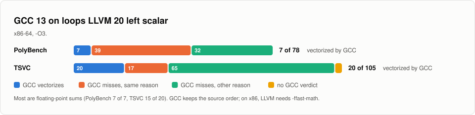
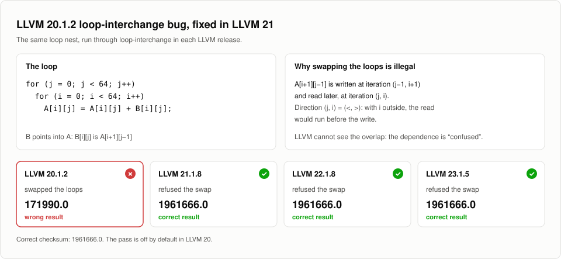

# Loop Vectorization Analyzer

[](https://github.com/Fe3w/Loop-Vectorization-Analyzer/actions/workflows/ci.yml)

An LLVM 20 plugin that explains why LLVM's loop vectorizer left a loop scalar, checks its answers
against LLVM, and repairs one class of blocked loops.

## How it works


- Runs inside `clang -O3`, just before LLVM's vectorizer, on the same code the vectorizer sees.
- Reports, for every loop, a category, the evidence and a source-level fix, using LLVM's own analyses.
- An opt-in repair pass rewrites one blocked loop pattern so that LLVM can vectorize it.

## Key results


- Gives the same reason as LLVM for **168 of 180** TSVC loops (mostly held out) and **all 163** PolyBench
  loops (tuning set) on x86-64.
- **13 of 14** suggested fixes make LLVM vectorize the loop.
- The repair keeps program output **byte-identical in 60 of 60 runs**.
- The repair speeds up cholesky by up to **5.79×** with `-ffast-math`, and **1.05×** without it.

## Comparisons

**Agreement by target.** Nearly all differences are LLVM cost-model decisions, which the analyzer
does not model.


<details>
<summary>Full agreement table</summary>

<!-- generated by scripts/results_table.py from results/*.csv; do not edit by hand -->
| Measure (PolyBench/C 4.2.1, clang-20 -O3 -g, x86-64; tuning set: rules were fixed on it) | Value |
| --- | --- |
| Kernels compiled | 30 |
| Innermost loops matched with a LoopVectorize verdict | 163 |
| LoopLens primary = LoopVectorize's first reason | 163 (100.0%) |
| ... or one of LoopLens's secondary categories | 163 (100.0%) |
| *every* LoopVectorize reason among LoopLens's categories | 163 (100.0%) |
| Loops unmatched / ambiguous | 0 / 0 |
| LLVM remark names without a mapping | none |

| Second suite (TSVC_2, one file, same flags; untuned first run: results/tsvc_agreement_summary_before.csv) | Value |
| --- | --- |
| Innermost loops matched with a LoopVectorize verdict | 180 |
| LoopLens primary = LoopVectorize's first reason | 168 (93.3%) |
| ... or one of LoopLens's secondary categories | 168 (93.3%) |
| *every* LoopVectorize reason among LoopLens's categories | 168 (93.3%) |
| Loops unmatched / ambiguous | 1 / 0 |

| Target | Flags | PolyBench agree / loops | TSVC agree / loops |
| --- | --- | --- | --- |
| x86-64 (generic) | (default) | 163 / 163 (100.0%) | 168 / 180 (93.3%) |
| x86-64-v4 (AVX-512) | `-march=x86-64-v4` | 163 / 163 (100.0%) | 180 / 180 (100.0%) |
| AArch64 | `--target=aarch64-linux-gnu` | 112 / 163 (68.7%) | 165 / 180 (91.7%) |
<!-- end generated -->

</details>

**Speedup per kernel.** Large gains require `-ffast-math`; nussinov and trmm do not gain.


**Against GCC 13.** GCC vectorizes 7 of 78 (PolyBench) and 20 of 105 (TSVC) loops that LLVM 20 leaves
scalar, mostly floating-point sums that GCC keeps in source order.



## Findings

- LLVM 20.1.2's loop-interchange can produce a wrong result when arrays overlap; LLVM 21 and later
  refuse the transformation.
- LLVM 20 refuses some loop interchanges that are legal.
- LLVM 20 already versions loops that only need alias checks, so the repair targets a different
  pattern: accumulation into an address that may overlap the loop's reads.



## Worked example

```c
float sum(const float *a, int n) {
  float s = 0.0f;
  for (int i = 0; i < n; i++)
    s += a[i];
  return s;
}
```

LLVM reports (line 14 of `test/clang/readme-example.c`):

```
readme-example.c:14:3: remark: loop not vectorized [-Rpass-missed=loop-vectorize]
remark: loop not vectorized: cannot prove it is safe to reorder floating-point operations
```

The analyzer reports, on the same line:

```
readme-example.c:14:3: remark: Category: reduction; Rule: red-exact-fp; Secondary: none;
  Evidence: fadd reduction %12 needs exact FP order;
  Fix: allow reassociation: -ffast-math or -fassociative-math, or #pragma clang loop vectorize(enable)
```

With `#pragma clang loop vectorize(enable)` above the loop, LLVM reports `vectorized loop`. The
example is a regression test, so it always matches the tool's output.

## Limitations

- **Single compiler version.** All results were obtained with LLVM 20.1.2; the rules mirror its
  legality checks and may require revision for later releases.
- **Legality, not profitability.** The analyzer models LoopVectorize's legality checks but not its
  cost model, so loops rejected as unprofitable are not predicted. This accounts for nearly all
  remaining disagreements and for the lower agreement on AArch64, which was evaluated by
  compilation only.
- **Evaluation scope.** PolyBench/C served as the tuning set and TSVC is largely held out; an
  untouched third suite would give a fully independent estimate.
- **Repair scope.** The repair addresses a single loop pattern, realizes its largest gains only when
  floating-point reassociation is permitted, and was timed on one x86 processor.

## Documentation

- [Setup and usage](docs/setup.md): requirements, build, commands, reproducing the results.
- [Reference](docs/reference.md): options, remarks, JSON report, rule table.
- [Technical write-up](docs/writeup.md): method, full results, discussion and next steps.
