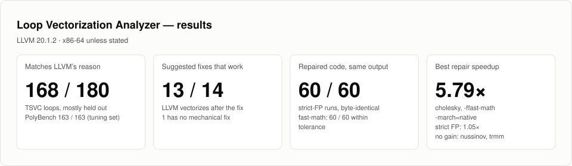
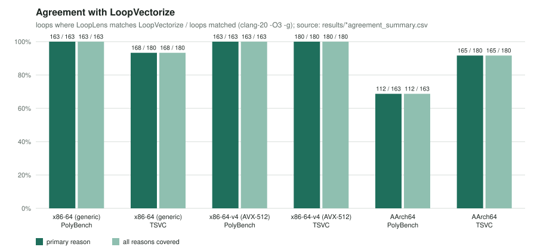
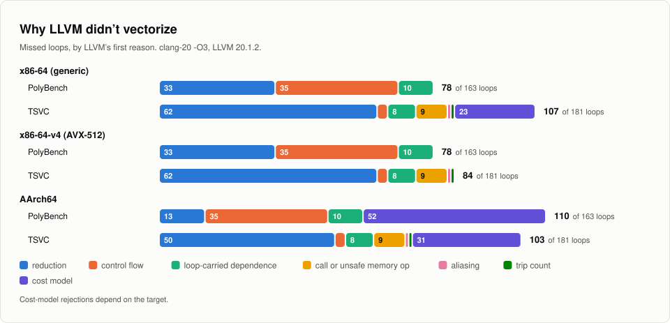
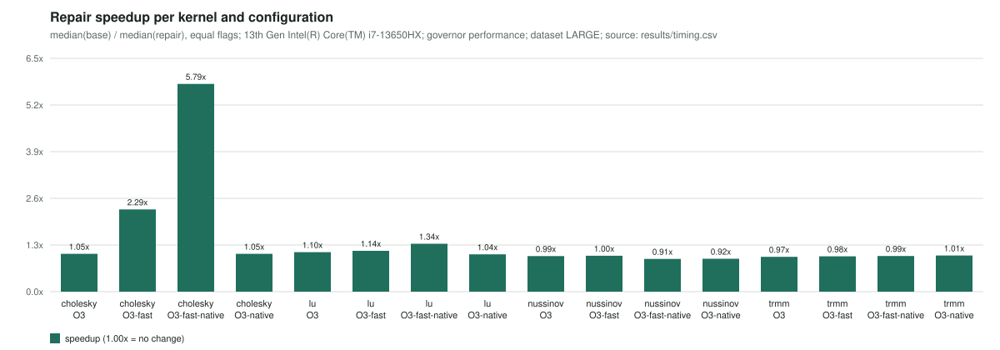
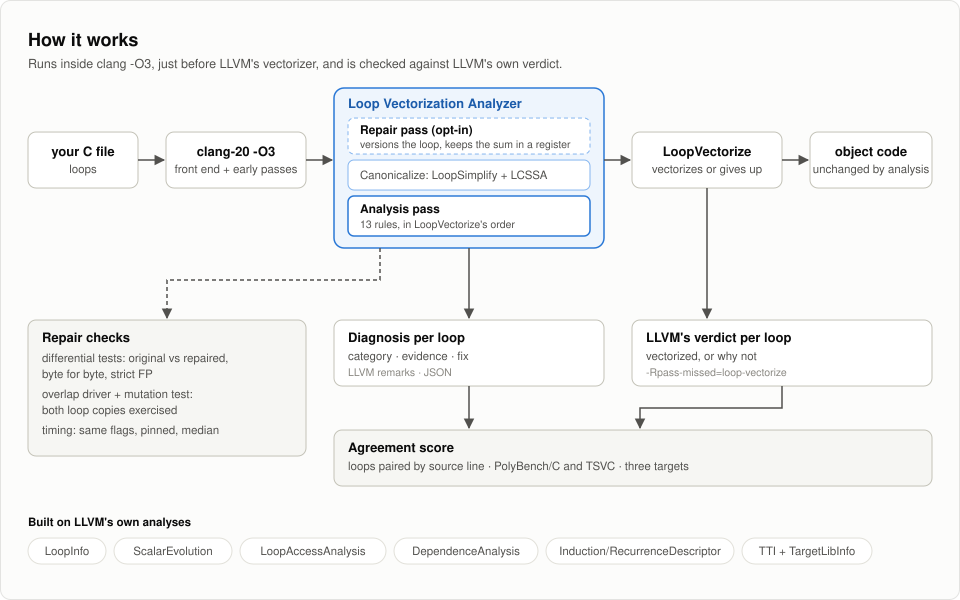

# Loop Vectorization Analyzer

[](https://github.com/Fe3w/Loop-Vectorization-Analyzer/actions/workflows/ci.yml)

An LLVM 20 plugin that explains why LLVM's loop vectorizer left a loop scalar: a category, the
evidence from LLVM's own analyses, and a source-level fix. It is scored against LLVM's own remarks,
and an opt-in repair pass fixes one class of blocked loops.



## Findings

| Finding | Evidence |
| --- | --- |
| **LLVM 20.1.2's loop-interchange can change a program's result.** It ignores a dependence it cannot analyze ("confused") when two arrays overlap. The pass is off by default in LLVM 20, and LLVM 21.1.8, 22.1.8 and 23.1.5 refuse the same nest. Not reported upstream, since it is already fixed. | [`confused-miscompile.test`](test/interchange/confused-miscompile.test), [`interchange_newer_llvm.txt`](results/interchange_newer_llvm.txt) |
| **LLVM 20 refuses some legal interchanges:** a nest inside a repetition loop, because of a `*` direction on a loop the swap does not move. | [`outer-repetition.ll`](test/interchange/outer-repetition.ll) |
| **77 of 78 disagreements with LLVM are cost-model decisions** ("not beneficial"). The analyzer checks legality the way LoopVectorize does but has no full cost model, which is why AArch64 scores lowest. A narrow cost rule was tried and rejected by a bar set in advance. | [`agreement.svg`](results/plots/agreement.svg), [`DECISIONS.md`](DECISIONS.md) |
| **GCC 13 vectorizes 7 of 78 (PolyBench) and 20 of 105 (TSVC) loops that LLVM 20 leaves scalar,** mostly floating-point sums that GCC keeps in source order. A policy difference, not a missed optimization. | [`gcc_compare.svg`](results/plots/gcc_compare.svg) |
| **At -O3, LLVM 20 already versions every loop that only needs alias checks.** So the repair targets a different blocker: accumulation into an address that may overlap what the loop reads. | [`repair-limits.md`](docs/repair-limits.md) |


## Results

### Agreement with LLVM

For every innermost loop, the analyzer's category is compared with the first reason LoopVectorize
gives in its remarks. PolyBench/C 4.2.1 was the tuning set; TSVC was held out except for one rule.



<!-- generated by scripts/results_table.py from results/*.csv; do not edit by hand -->
| Measure (PolyBench/C 4.2.1, clang-20 -O3 -g, x86-64; tuning set: rules were fixed on it) | Value |
| --- | --- |
| Kernels compiled | 30 |
| Innermost loops matched with a LoopVectorize verdict | 163 |
| LoopLens primary = LoopVectorize's first reason | 163 (100.0%) |
| ... or one of LoopLens's secondary categories | 163 (100.0%) |
| *every* LoopVectorize reason among LoopLens's categories | 163 (100.0%) |
| Loops unmatched / ambiguous | 0 / 0 |
| LLVM remark names without a mapping | none |

| Second suite (TSVC_2, one file, same flags; untuned first run: results/tsvc_agreement_summary_before.csv) | Value |
| --- | --- |
| Innermost loops matched with a LoopVectorize verdict | 180 |
| LoopLens primary = LoopVectorize's first reason | 168 (93.3%) |
| ... or one of LoopLens's secondary categories | 168 (93.3%) |
| *every* LoopVectorize reason among LoopLens's categories | 168 (93.3%) |
| Loops unmatched / ambiguous | 1 / 0 |

| Target | Flags | PolyBench agree / loops | TSVC agree / loops |
| --- | --- | --- | --- |
| x86-64 (generic) | (default) | 163 / 163 (100.0%) | 168 / 180 (93.3%) |
| x86-64-v4 (AVX-512) | `-march=x86-64-v4` | 163 / 163 (100.0%) | 180 / 180 (100.0%) |
| AArch64 | `--target=aarch64-linux-gnu` | 112 / 163 (68.7%) | 165 / 180 (91.7%) |
<!-- end generated -->



Method: [docs/methodology.md](docs/methodology.md). Every loop is a row in `results/*agreement.csv`;
the disagreements found and fixed along the way are in
[results/disagreements.md](results/disagreements.md) and
[results/tsvc_disagreements.md](results/tsvc_disagreements.md). Loading the plugin does not change
the generated code ([results/codegen_check.txt](results/codegen_check.txt)).

### Repair

The repair pass versions a loop that accumulates into a possibly-overlapping address and keeps the
value in a register in the fast copy.



- **Correct:** 60 / 60 strict-FP PolyBench runs byte-identical. An overlap driver runs both loop
  copies, and a mutation test shows the runtime check is needed
  ([docs/correctness.md](docs/correctness.md)).
- **Fast only with `-ffast-math`:** in strict FP the repaired loop stays scalar, so cholesky and lu gain
  only 1.04–1.10×. With
  `-ffast-math` it vectorizes: up to 5.79× on cholesky with `-march=native`.
- **Not everywhere:** nussinov and trmm gain nothing; four loops it does not turn into vector code
  are explained in [docs/repair-limits.md](docs/repair-limits.md).

Timing: one laptop CPU (i7-13650HX), governor `performance`, PolyBench LARGE, median of 10 runs
([results/timing.csv](results/timing.csv), [docs/writeup.md](docs/writeup.md#measured-speedup)).

## Worked example

```c
float sum(const float *a, int n) {
  float s = 0.0f;
  for (int i = 0; i < n; i++)
    s += a[i];
  return s;
}
```

LLVM says (the loop is on line 14 of `test/clang/readme-example.c`):

```
readme-example.c:14:3: remark: loop not vectorized [-Rpass-missed=loop-vectorize]
remark: loop not vectorized: cannot prove it is safe to reorder floating-point operations
```

The analyzer says, on the same line:

```
readme-example.c:14:3: remark: Category: reduction; Rule: red-exact-fp; Secondary: none;
  Evidence: fadd reduction %12 needs exact FP order;
  Fix: allow reassociation: -ffast-math or -fassociative-math, or #pragma clang loop vectorize(enable)
```

Add `#pragma clang loop vectorize(enable)` above the loop and LLVM reports `vectorized loop`. This
example is a test (`test/clang/readme-example.c`), so it cannot drift from what the tool prints.

## How it works



- **Where it runs.** Inside clang, at LLVM's VectorizerStart extension point, right before
  LoopVectorize, after the same canonicalization (LoopSimplify, LCSSA). It sees the IR the
  vectorizer sees.
- **Facts, not re-implementations.** Trip counts from ScalarEvolution; inductions and reductions
  from LLVM's descriptors; dependences and runtime checks from LoopAccessAnalysis; call
  vectorizability from the same test LoopVectorize uses.
- **Rules in LLVM's order.** 13 rules in 8 categories, checked in the order LoopVectorize runs its
  own checks, so the primary blocker is the first one LoopVectorize would stop at. Rule table:
  [docs/reference.md](docs/reference.md#output-reference-text-report-via-opt).

## Limits

- One LLVM version (20.1.2). AArch64 is compile-only and the weakest target (68.7% on PolyBench).
- PolyBench is the tuning set; TSVC is mostly held out (one rule came from it).
- No full cost model: "not beneficial" decisions are not predicted.
- The repair covers one loop pattern and pays off only with `-ffast-math` or the vectorize pragma.
  Speedups come from one x86 laptop CPU.

More in [docs/writeup.md](docs/writeup.md#limits).

## Build and use

> **Names.** The repository is called *Loop-Vectorization-Analyzer*; inside it the project keeps its
> original name, **LoopLens**. The plugin builds as `build/lib/LoopLens.so`, the passes are
> `looplens-analyze` and `looplens-repair`, options start with `-looplens-`, and remarks use the
> pass name `looplens`. The old URL `github.com/Fe3w/looplens` redirects here.

Requirements: Ubuntu 24.04 with LLVM 20 from `noble-updates` (the same packages CI installs):

```bash
sudo apt-get install -y -t noble-updates llvm-20 llvm-20-dev llvm-20-tools libpolly-20-dev \
  clang-20 zlib1g-dev libzstd-dev ninja-build cmake python3-yaml
```

```bash
git clone https://github.com/Fe3w/Loop-Vectorization-Analyzer.git
cd Loop-Vectorization-Analyzer
cmake -S . -B build -G Ninja
cmake --build build
cmake --build build --target check     # lit + FileCheck tests
```

Explain the loops in a file:

```bash
P=build/lib/LoopLens.so
clang-20 -O3 -g -fpass-plugin=$P -Xclang -load -Xclang $P -mllvm -looplens-text=false \
  -Rpass-analysis='looplens|loop-vectorize' -Rpass-missed=loop-vectorize -c foo.c
```

Add `-mllvm -looplens-repair` to run the repair pass. Options, remarks, the JSON report and the full
text output: [docs/reference.md](docs/reference.md).

## Reproduce

```bash
scripts/reproduce.sh          # build, test, download (checksummed), collect, score, update README
scripts/reproduce.sh --dry-run
python3 scripts/plots.py      # redraw the figures in results/plots/ from results/
```

The `reproduce` GitHub workflow (manual and weekly) runs the same script and fails if any committed
result changes.

## Documentation

| Document | Contents |
| --- | --- |
| [docs/writeup.md](docs/writeup.md) | Technical write-up: design, results, limits, next steps |
| [docs/reference.md](docs/reference.md) | Options, remarks, JSON report, text output, rule table |
| [docs/methodology.md](docs/methodology.md) | How agreement with LLVM is computed |
| [docs/correctness.md](docs/correctness.md) | Evidence that the repair does not change results |
| [docs/repair-limits.md](docs/repair-limits.md) | What the repair fixes and what it does not |
| [DECISIONS.md](DECISIONS.md) | One line per design decision |
| [CHANGELOG.md](CHANGELOG.md) | Releases |

## Layout

| Path | Contents |
| --- | --- |
| `lib/` | Pass sources |
| `test/` | lit/FileCheck regression tests |
| `bench/` | PolyBench/C and TSVC harness |
| `results/` | CSVs and figures; the only source of reported numbers |
| `scripts/` | Data collection, scoring, figures |
| `docs/` | Write-up, reference, methodology |
