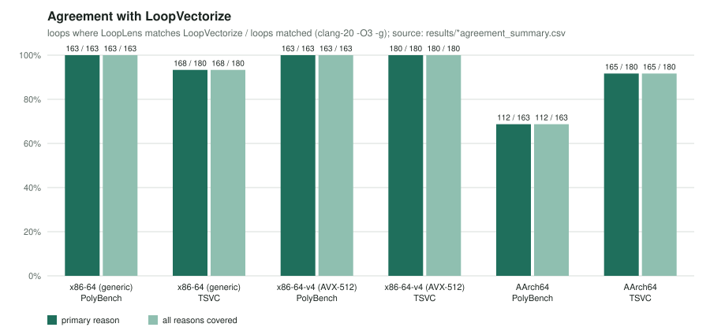
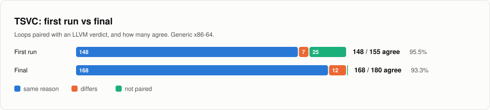

# LoopLens: a technical write-up

## What it does

When LLVM's loop vectorizer (LoopVectorize) leaves a loop scalar, its remark says *that* it did
("loop not vectorized") and sometimes a terse reason. LoopLens is an out-of-tree LLVM 20 plugin that
runs right before the vectorizer inside a normal `clang -O3` build and reports, for every innermost
loop, a blocker category, the evidence behind it, and a source-level fix. A second pass,
`looplens-repair`, removes one kind of blocker by transforming the loop. Scripts score LoopLens's
diagnoses against LoopVectorize's own remarks.

## How it works

**It asks LLVM, it does not re-derive.** Every fact comes from the analysis LoopVectorize itself
uses: trip counts from ScalarEvolution; induction variables and reductions from `InductionDescriptor`
and `RecurrenceDescriptor`; memory safety, dependences and runtime checks from LoopAccessAnalysis;
call vectorizability from the same test LoopVectorize applies (`getVectorIntrinsicIDForCall`,
`VFDatabase`, TargetLibraryInfo); target facts (ordered FP reductions, legal gathers) from
TargetTransformInfo.

**One rule table, in LoopVectorize's order.** The rules are checked in the order LoopVectorize's own
checks run: loop hints, control flow and if-conversion, phis and instructions, countability, memory,
FP reordering, and finally the cost model. The *primary* blocker is therefore the first thing
LoopVectorize would stop at; the others are listed as secondary. Getting this order right mattered:
LoopVectorize checks FP reordering only after legality passes, and placing that rule too early was
one of the bugs the measurement found (`results/disagreements.md`).

**It sees what the vectorizer sees.** Inside clang the plugin registers at the VectorizerStart
extension point and first runs LoopSimplify and LCSSA, as LoopVectorize does before its own checks.
Loading the plugin does not change the generated code: the assembly of all 30 PolyBench kernels is
identical with and without it (`results/codegen_check.txt`).

**Every suggested fix is tried.** For each rule, `scripts/verify_fixes.sh` applies the suggested fix
to a small example and checks that LLVM 20 then vectorizes it: 13 of 14 fixes are verified
(`results/fix_verification.csv`); the remaining rule, an unsupported recurrence, has no mechanical fix.

**What a fix is worth, statically.** `scripts/fix_mca.py` cuts the hot loop out of clang's assembly
before and after each fix and asks llvm-mca for its steady-state cost. The figure is cycles per
source element: block reciprocal throughput divided by the vector width (`results/fix_mca.csv`;
generic x86-64, or x86-64-v4 for the gather fix). Nine fixes get an estimate:

| Estimated speedup (before / after) | Fixes |
| --- | --- |
| 4.00 | cost-strided, hint-vectorize-disabled, mem-non-simple, mem-unsafe-dep, red-exact-fp |
| 2.89 | trip-uncountable |
| 2.13 | stride-gather (x86-64-v4) |
| 2.00 | cfg-uncountable-early-exit |
| 1.20 | mem-no-runtime-check (scatter emulated with scalar stores, width 2) |

Four fixes get no ratio because a call is in the loop, and llvm-mca prices a call as one
instruction: both call examples, `mem-call-writes`, and `cfg-unpredicable` (its before loop calls
`sqrtf`). The model has no caches, memory bandwidth, loop entry or exit, remainder loop or
runtime-check cost. So these are optimistic estimates for long loops whose data stays in cache, not
measurements. Measured timings come only from the laptop timing run.

## Results

Agreement means: LoopLens's primary category equals the category of LoopVectorize's first reason for
the same loop. The method is in [methodology.md](methodology.md); every row is in the
`results/*agreement.csv` files and the totals below are from `results/*agreement_summary.csv`.

| Target | PolyBench/C 4.2.1 (30 kernels) | TSVC_2 |
| --- | --- | --- |
| x86-64 (generic) | 163 / 163 | 168 / 180 (93.3%) |
| x86-64-v4 (AVX-512) | 163 / 163 | 180 / 180 |
| AArch64 (compile-only) | 112 / 163 (68.7%) | 165 / 180 (91.7%) |

The second metric, whether *all* of LoopVectorize's reasons are among LoopLens's categories, gives
the same counts: every remaining miss is a cost-model verdict for which LoopLens has no category.

TSVC's first, untuned run agreed on 148 of 155 matched loops
(`results/tsvc_agreement_summary_before.csv`); it matched fewer loops because the scorer then
mis-attributed some of LoopVectorize's verdicts (`results/tsvc_disagreements.md`). The current run
agrees on 168 of 180.

### A second compiler: GCC 13

`scripts/gcc_compare.py` compiles the same sources with `gcc-13 -O3 -g -fopt-info-vec-all` (same
includes, no extra flags) and joins GCC's verdict and one-line reason to each loop by file and line
(`results/gcc_compare_{polybench,tsvc}{,_summary}.csv`).

| Generic x86-64 | PolyBench | TSVC |
| --- | --- | --- |
| Loops LLVM vectorizes / GCC also vectorizes | 85 / 82 | 73 / 60 |
| Loops LLVM leaves scalar | 78 | 105 |
| … GCC vectorizes | 7 | 20 |
| … GCC also refuses, reason maps to LoopLens's category | 39 | 17 |
| … GCC also refuses, another reason | 32 | 65 |
| … no GCC verdict | 0 | 3 |

- **Where GCC wins, the loops are mostly exact-FP reductions:** all 7 on PolyBench and 12 of the 20 on
  TSVC (rule `red-exact-fp`). GCC 13 vectorizes them as in-order ("fold-left") reductions, which are
  legal without `-ffast-math`; its code for a plain sum keeps the scalar adds in source order
  (`test/scripts/gcc-compare-run.test`). LLVM 20 does the same only where the target asks for it
  (AArch64). So this is a target-policy difference, not a missed optimisation. The other TSVC wins are
  3 `stride-gather`, 3 `recur-unsupported`, 1 `cost-strided` and 1 loop LoopLens marks `none`.
- **Same reason when both refuse:** every PolyBench control-flow loop (35 of 35). Elsewhere GCC's
  summary line is too coarse to compare. For example, `mean[j] += data[i][j]` (correlation.c:82), a reduction
  that also walks a column, gets "complicated access pattern"; 20 PolyBench reduction loops get that
  reason. Most TSVC refusals say "no vectype for stmt" (39).
  The mapping table is in the script, and the CSV keeps GCC's text.

## The repair

`looplens-repair` targets a loop that accumulates into a loop-invariant address which may overlap
what the loop reads, such as cholesky's `A[i][j] -= A[i][k] * A[j][k]`. It versions the loop on "the
accumulated address lies outside every range read" and keeps the value in a register in the fast
copy. It transforms 5 PolyBench loops (trmm 1, cholesky 1, lu 2, nussinov 1). With `-ffast-math`,
three more loops then vectorize (cholesky and both lu loops; `results/repair_differential.csv`,
columns `fast_vectorized_base` and `fast_vectorized_repair`).

Evidence that it does not change results ([correctness.md](correctness.md)): all 60 PolyBench runs
(30 kernels, SMALL and MEDIUM datasets) are byte-identical in strict FP; a driver with overlapping
arrays exercises both copies of each repaired loop, and a mutation test shows that driver fails when
the runtime check is removed; with `-ffast-math` all 60 runs are within a tolerance fixed in advance
(largest absolute difference 0.01, one unit in the last printed digit).

**Speedups are not reported here.** The timing harness (`bench/timing/time.sh`) compares original
and repaired builds only under identical flags, but no measured run exists yet: timings from shared
cloud machines are too noisy to publish, and the run on a quiet machine is still to be done. The
speedup plot will be generated from `results/timing.csv` once it exists.

## Limits

- **PolyBench is the tuning set.** Rules were fixed on its disagreements, so its 163 / 163 on x86 is
  not a held-out result.
- **TSVC is mostly held out.** One rule (`cost-strided`) was derived from TSVC's cost-model misses,
  so it is no longer fully independent; its untuned first run is kept for comparison.
- **AArch64 is weak and compile-only.** PolyBench agreement there is 68.7%. Most misses are loops
  LoopVectorize rejects as not profitable because their arithmetic is expensive on that target;
  LoopLens has no full cost model. Nothing was run on AArch64 hardware. A narrow cost rule (X1) was
  tried and rejected: pricing integer division/remainder, FP division and int↔FP conversions one
  operation at a time through TTI raised AArch64 PolyBench agreement (to 140 or 136 of 163) but
  changed both x86 targets (generic x86-64 PolyBench fell to 122 or 130 of 163) and lowered AArch64
  TSVC (165 → 164), failing the bar set in advance. Per-operation prices miss how LoopVectorize
  amortises an expensive operation over the whole loop body. The rejected runs are kept in
  `results/x1_try*_rejected.csv`.
- **The repair needs FP reordering to pay off.** The repaired loops vectorize only with
  `-ffast-math` or `#pragma clang loop vectorize(enable)`; in strict FP the repair removes the
  dependence but the reduction still cannot be reordered.
- **Four PolyBench loops the repair does not turn into vector code**
  ([repair-limits.md](repair-limits.md)): trmm and nussinov are repaired but then rejected by the cost
  model (column walks); bicg and gesummv have more than one store and fall outside the pattern.
- **Interchange is LLVM's, not LoopLens's.** For column walks (`cost-strided`) LoopLens decides
  whether interchanging the loop with its parent is legal. It works from DependenceAnalysis direction
  vectors: a `(<,>)` or `(>,<)` pair makes the swap illegal. When the swap is legal, the fix names
  LLVM's own `loop-interchange` (`-mllvm -enable-loopinterchange`, off by default in LLVM 20); LoopLens
  does not transform the nest itself. Compared with that pass, LoopLens is stricter in one case and
  more precise in another:
  - **Overlapping arrays.** LLVM 20 drops "confused" dependences, so it interchanges a nest whose
    arrays may overlap. `test/interchange/confused-miscompile.test` runs such a program under `lli`;
    the checksum changes after LLVM's interchange. LoopLens reports `unknown` there.
  - **Repetition loop.** LLVM 20 refuses nests inside a repetition loop because of that loop's `*`
    direction, which the swap does not move (`outer-repetition.ll`). LoopLens calls these legal.

  `results/interchange_tsvc.csv` (`scripts/interchange_oracle.py`, generic x86-64) has a verdict for
  six TSVC loops; LLVM's pass agrees on 5. The exception is s1232 (`tsvc.c:1141`): LoopLens calls the swap legal
  but says it must be done by hand, because the nest is triangular (`i = j..N`). LLVM refuses it
  because of the repetition loop's `*` direction, and its pass cannot rewrite triangular bounds in
  any case. PolyBench has no `cost-strided` loop at
  `-O3`.
- **One LLVM version.** Everything is LLVM 20.1.2; several rules encode LLVM 20 behaviour that later
  releases change (early-exit vectorization is off by default in 20).

## What to try next

- Report LLVM 20's confused-dependence interchange to upstream after checking a current LLVM.
- A cost model for AArch64 that prices the whole loop body the way LoopVectorize does (VPlan-level
  cost), since per-operation pricing was rejected (X1).
- Extend the repair to two accumulators (gesummv) by also checking the accumulators against each other.
- Measure the repair's speedup on a quiet machine and on AArch64 hardware.
- A third, never-touched benchmark suite, to replace TSVC as the held-out check.
